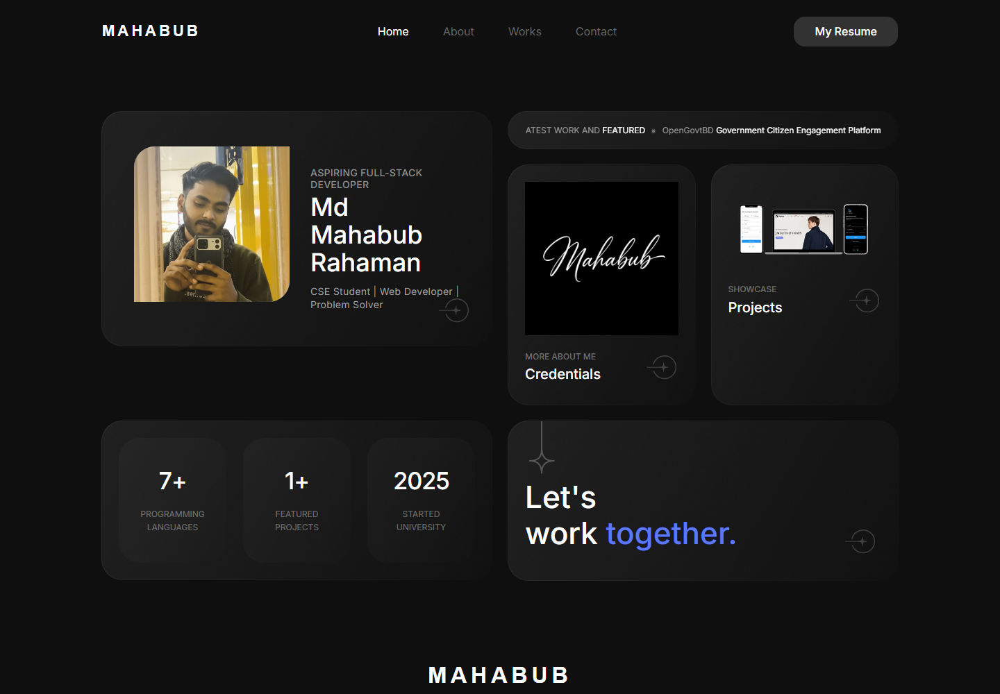
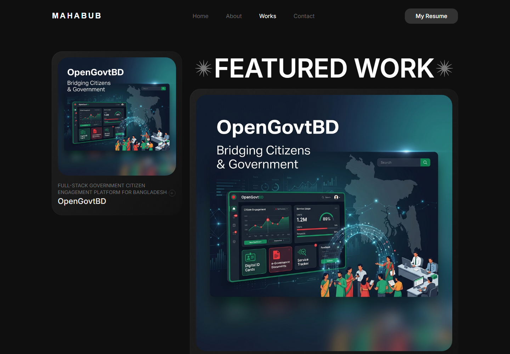

<div align="center">

# 👋 Hi, I'm Md Mahabub Rahaman

### Aspiring Full-Stack Web Developer · CSE Student at Daffodil International University

*"Learn. Build. Solve. Repeat."*

<p>
  
  
  
  
  
</p>

<p>
  <a href="https://github.com/mahabub-rahaman-001"></a>
  <a href="https://www.linkedin.com/in/md-mahabub-rahaman-cmmr"></a>
  <a href="mailto:contactmahabubrahaman@gmail.com"></a>
  
</p>

<!-- Add your live link here once deployed, e.g.:
<a href="https://YOUR-DOMAIN"></a>
-->



</div>

---

## ✨ About This Project

My personal portfolio website: a dark, card-based design that shows who I am, what I'm learning, and what I've built. It's a fast **static site** with no build step, so it can be hosted anywhere.

## 🚀 Features

| | Feature | Details |
|---|---|---|
| 🎨 | **Modern dark UI** | Card-based layout with smooth hover effects |
| 🎬 | **Scroll animations** | Elements animate in with [AOS](https://michalsnik.github.io/aos/) |
| 📱 | **Fully responsive** | Works on mobile, tablet, and desktop |
| 📬 | **Working contact forms** | AJAX submission through [Formspree](https://formspree.io) with inline success/error messages, validation, and spam protection |
| 📄 | **Interactive CV** | Separate resume page with tabbed sections |
| 🗂️ | **Project case study** | Detailed write-up for each featured project |
| 🔗 | **Share-ready** | Open Graph and Twitter meta tags for rich link previews |
| ⬆️ | **Scroll-to-top** | Quick-return button on long pages |

## 🛠️ Built With

- **HTML5 & CSS3**: page structure and custom styling
- **JavaScript & jQuery**: interactivity, mobile menu, contact form handling
- **Bootstrap 5**: responsive grid and layout
- **AOS (Animate On Scroll)**: scroll animations
- **Iconoir & Ionicons**: icons
- **Formspree**: contact-form-to-email delivery (no backend needed)

## 📂 Pages

| Page | Description |
|---|---|
| [`index.html`](./index.html) | 🏠 Home: intro, highlights, and quick links |
| [`about.html`](./about.html) | 🙋 About: self-summary, skills, and education |
| [`works.html`](./works.html) | 💼 Projects: featured work |
| [`work-details.html`](./work-details.html) | 🔍 OpenGovtBD case study |
| [`credentials.html`](./credentials.html) | 🎓 Skills, goals, and education |
| [`contact.html`](./contact.html) | ✉️ Contact form and social links |
| [`cv.html`](./cv.html) | 📄 Interactive resume |

## 🌟 Featured Project: OpenGovtBD



**OpenGovtBD** is a full-stack Government Citizen Engagement Platform for Bangladesh 🇧🇩. It aims to make government services and information more accessible, organized, and user-friendly.

**Stack:** React · Node.js · JavaScript · HTML/CSS

👉 [View the repository](https://github.com/mahabub-rahaman-001/OpenGovtBD)

## 📁 Project Structure

```
mahabub-portfolio/
├── index.html            # Home
├── about.html            # About
├── works.html            # Projects
├── work-details.html     # Project case study
├── credentials.html      # Skills & education
├── contact.html          # Contact form
├── cv.html               # Resume
├── serve.ps1             # Local dev server (Windows)
├── screenshots/          # README images
└── assets/
    ├── css/              # style.css, cv-style.css, Bootstrap, AOS
    ├── js/               # main.js, ajax-form.js, cv-script.js, libraries
    └── images/           # photos, icons, project images
```

## 💻 Run Locally

```bash
# 1. Clone the repository
git clone https://github.com/mahabub-rahaman-001/mahabub-portfolio.git
cd mahabub-portfolio
```

```powershell
# 2a. Windows (PowerShell): start the included server
./serve.ps1
# then open http://localhost:8765
```

```bash
# 2b. Any OS with Python installed
python -m http.server 8000
# then open http://localhost:8000
```

> 💡 Opening `index.html` directly also works, but the contact form needs the site to be served over `http://` to submit.

## 🌐 Deploy

This is a static site, so it can be deployed for free as-is:

- **GitHub Pages**: *Settings → Pages →* deploy from the `main` branch
- **Netlify**: drag and drop the project folder
- **Vercel**: import the repository; no build settings needed

## 📬 Contact

I'm always open to learning opportunities, collaborations, and new ideas.

- 📧 **Email:** [contactmahabubrahaman@gmail.com](mailto:contactmahabubrahaman@gmail.com)
- 💼 **LinkedIn:** [md-mahabub-rahaman-cmmr](https://www.linkedin.com/in/md-mahabub-rahaman-cmmr)
- 🐙 **GitHub:** [mahabub-rahaman-001](https://github.com/mahabub-rahaman-001)

---

<div align="center">

⭐ **If you like this project, consider giving it a star!** ⭐

© Md Mahabub Rahaman. All rights reserved.

</div>
